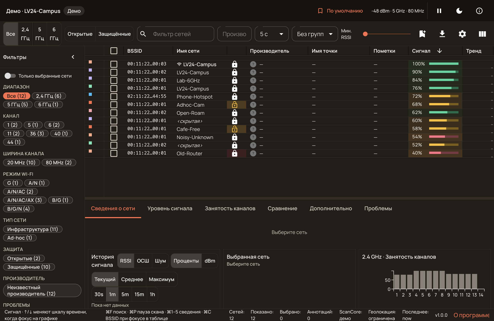
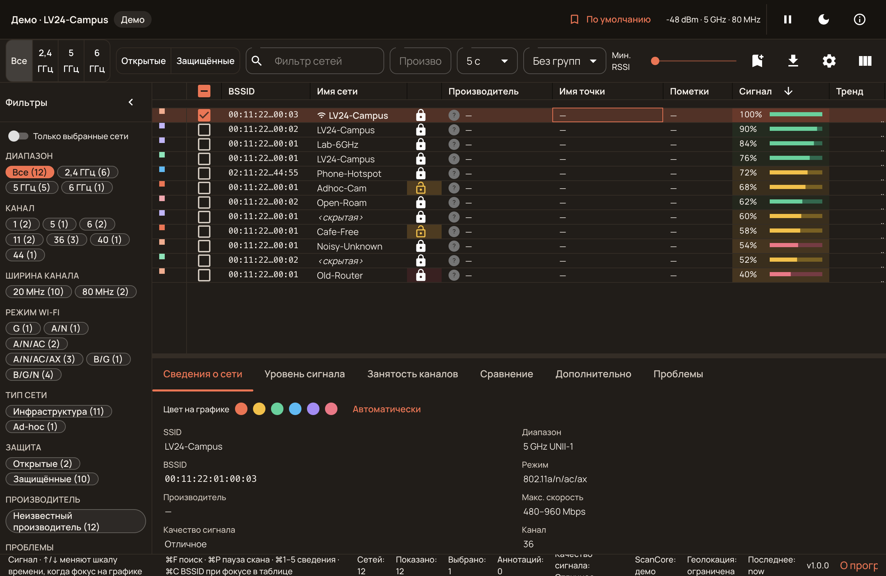
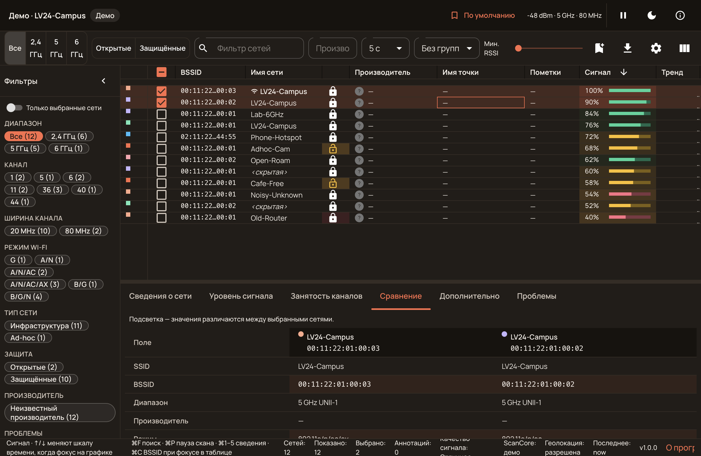
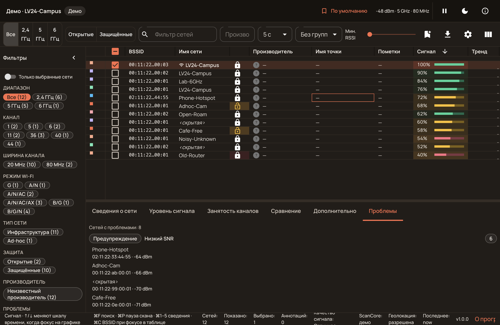
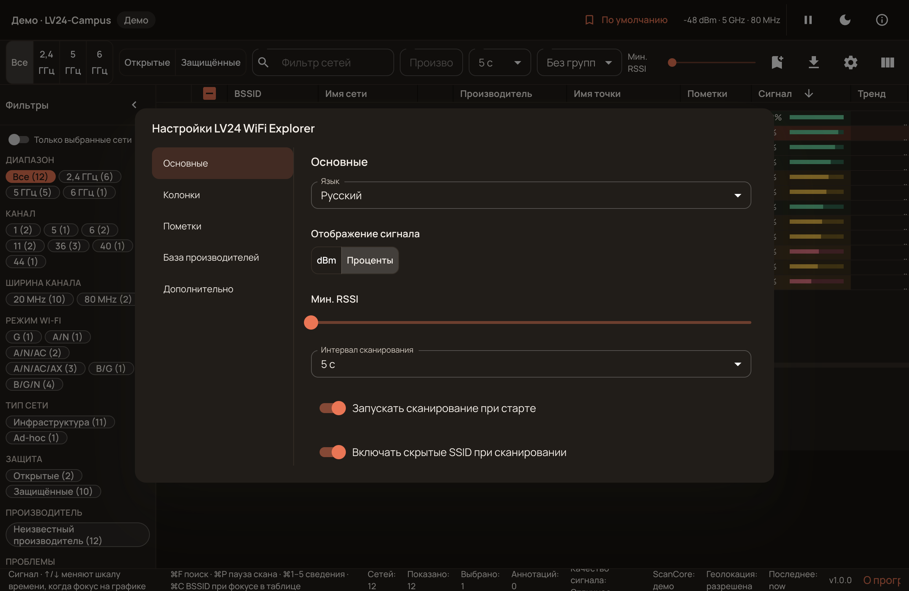
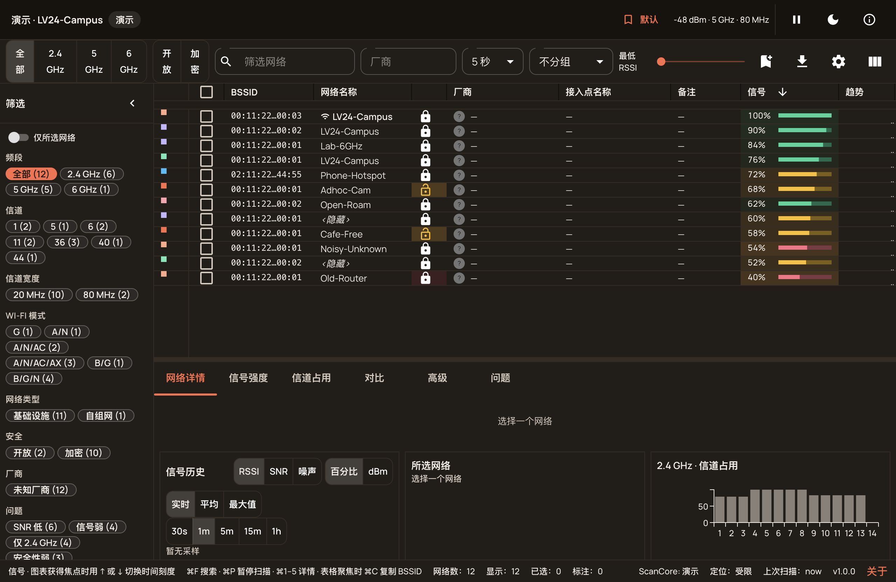

# LV24 WiFi Explorer

[](https://www.npmjs.com/package/@lv24/wifi-core)
[](https://www.npmjs.com/package/@lv24/wifi-mcp)
[](https://github.com/LevapVeeskela/lv24-Wifi-Explorer/releases)
[](LICENSE)
[](#cross-platform-scan-sources)

**A fast, honest Wi‑Fi scanner — for people and for AI agents.** Live CoreWLAN
scans on macOS, NetworkManager on Linux, `netsh` on Windows, deterministic demo
fixtures everywhere. The same domain model powers the desktop app, the CLI and
an MCP server that agents can query.

> **Кратко по-русски.** Честный сканер Wi‑Fi: живой эфир на macOS (CoreWLAN),
> Linux и Windows, без выдуманных данных. Есть десктопное приложение, CLI и
> MCP-сервер для ИИ-агентов — агент видит те же сети, каналы и проблемы, что и
> человек в приложении. Интерфейс на русском, английском и китайском.
> Установка: [Releases](https://github.com/LevapVeeskela/lv24-Wifi-Explorer/releases)
> (Windows/Linux) или [DMG для macOS](https://github.com/LevapVeeskela/lv24-Wifi-Explorer/releases/tag/v1.0.0),
> `npm i -g @lv24/wifi-cli` или `npx -y @lv24/wifi-mcp`.

| 🚀 Start                                                                   | 🧠 Use                                                    | 🤖 Agents                                            |
| -------------------------------------------------------------------------- | --------------------------------------------------------- | ---------------------------------------------------- |
| [Download](#desktop-app-macos) · [CLI](#cli) · [Build](#build-from-source) | [Features](#why-it-is-nice) · [Screenshots](#screenshots) | [MCP server](#mcp-for-agents) · [llms.txt](llms.txt) |

<p align="center">
  
</p>

## Screenshots

Screenshots use the deterministic demo provider — no real networks are exposed.

| Workbench (RU)                                     | Network details                                        |
| -------------------------------------------------- | ------------------------------------------------------ |
|       |  |
| **BSS compare**                                    | **Issues inspector**                                   |
|  |  |
| **Settings (language, signal units, scanning)**    | **Simplified Chinese UI**                              |
|    |       |

## Why it is nice

- **Real data, no stubs.** Live SSID/BSSID/vendor on macOS once the signed
  helper has Location; RF-only redaction is explicit, never fake “hidden” names.
- **Answers “why is my Wi‑Fi bad?”** Signal/noise/SNR history, same-SSID and
  same-channel occupancy, issue heuristics, BSS compare with IE diff, IE tree.
- **Workbench, not a black box.** Filter presets, saved workbench profiles,
  annotations, named coloring rules, column profiles, CSV/print/snapshot export,
  pcap/pcapng import.
- **Agents get the same picture.** `@lv24/wifi-mcp` exposes scan, summary,
  channels and issues over MCP — no screen scraping, no duplicated logic.
- **Three UI languages.** Russian, English and Simplified Chinese, switchable
  live in Settings (desktop and Flutter).
- **One model everywhere.** `@lv24/wifi-core` powers the app, CLI, MCP and
  Flutter client; Linux/Windows providers degrade honestly.
- **Open and reusable.** MIT core/backend/CLI/MCP packages, typed provider API,
  demo provider for CI, no private APIs in the core.

## Desktop app (macOS)

1. Download `LV24-WiFi-Explorer-1.0.0-arm64-public.dmg` from the
   [v1.0.0 release](https://github.com/LevapVeeskela/lv24-Wifi-Explorer/releases/tag/v1.0.0)
   (the macOS artifact is not rebuilt for every desktop patch).
2. Open it and drag the app to **Applications**.
3. First launch: **right-click → Open** (the build is signed but not yet
   notarized — see [Known limitations](#known-limitations)).
4. Grant **Location** once to `ScanCore` — macOS treats Wi‑Fi names as location
   data. Without it the app shows the demo badge instead of inventing names.

The public DMG is built **without** the commercial MUI key, so the data grid
shows a small MUI watermark. A private, watermark-free build is documented in
[`docs/RELEASE.md`](docs/RELEASE.md).

### Linux / Windows desktop

Ready-made installers are attached to the latest
[release](https://github.com/LevapVeeskela/lv24-Wifi-Explorer/releases):
`LV24-WiFi-Explorer-1.0.3-win-x64.exe` (NSIS) and
`LV24-WiFi-Explorer-1.0.3-linux-x86_64.AppImage`. `yarn dist:linux` /
`yarn dist:win` produce the same installers from source. Live scanning on Linux
uses NetworkManager (`nmcli`), on Windows `netsh`; both expose fewer fields than
macOS (see the table below). Windows/Linux packages are not signed.

On Windows, the Scoop bucket is live:

```powershell
scoop bucket add lv24 https://github.com/LevapVeeskela/scoop-bucket
scoop install lv24/lv24-wifi-explorer
```

The winget manifest is in review (`microsoft/winget-pkgs` PR #475989). The free
channels and their exact prerequisites are tracked in
[`docs/DISTRIBUTION.md`](docs/DISTRIBUTION.md). Nothing there is auto-published:
Windows/Linux assets are built by the manual
[`release-desktop.yml`](.github/workflows/release-desktop.yml) workflow.

## CLI

```bash
npm i -g @lv24/wifi-cli

lv24-wifi providers                  # what this machine can scan
lv24-wifi scan --format table        # live scan
lv24-wifi scan --ssid "Cafe" --format json
lv24-wifi scan --provider demo --format json --out scan.json
```

The CLI is the same engine as the app: providers, display names, bands,
security and IE decoding. `--format json` is agent-friendly; `--count` and
`--interval` control pacing.

## MCP for agents

```bash
npx -y @lv24/wifi-mcp
```

`@lv24/wifi-mcp` is a stdio MCP server with six tools:

| Tool             | What an agent gets                                                      |
| ---------------- | ----------------------------------------------------------------------- |
| `wifi_providers` | providers available here + honest capability gaps                       |
| `wifi_scan`      | active scan → compact BSS rows (`limit`, `fields`)                      |
| `wifi_network`   | one BSS by BSSID (cache or fresh scan)                                  |
| `wifi_summary`   | band/security/vendor counts, busiest channels, strongest/weakest        |
| `wifi_channels`  | per-channel utilization + beacon-overhead **estimate**                  |
| `wifi_issues`    | issue heuristics: low signal, overlap, open security, DFS, hidden SSID… |

OpenCode (`opencode.json`):

```json
{
  "$schema": "https://opencode.ai/config.json",
  "mcp": {
    "lv24-wifi": {
      "type": "local",
      "command": ["npx", "-y", "@lv24/wifi-mcp"],
      "enabled": true
    }
  }
}
```

Claude Desktop (`claude_desktop_config.json`) and Cursor use the same
`mcpServers` shape. Full setup, macOS helper env vars and data-honesty notes:
[`docs/MCP.md`](docs/MCP.md). Machine-readable project summary for agents:
[`llms.txt`](llms.txt).

## Container image (GHCR)

A headless image with the CLI and the MCP server (no Electron/Flutter UI) is
published manually to GitHub Container Registry:

```bash
docker run --rm ghcr.io/levapveeskela/lv24-wifi-explorer providers
docker run --rm ghcr.io/levapveeskela/lv24-wifi-explorer scan --provider demo
docker run -i --rm ghcr.io/levapveeskela/lv24-wifi-explorer mcp
```

`--provider demo` works everywhere. Live Linux scans are **not** available in
the image: `linux-nmcli` needs NetworkManager and D-Bus on the host. Build it
locally with `docker build -f docker/Dockerfile -t lv24-wifi-explorer .`; publish
with the manual [`ghcr-publish.yml`](.github/workflows/ghcr-publish.yml)
workflow. Details: [`docs/PACKAGES.md`](docs/PACKAGES.md#github-native-distribution).

## Python / PyPI launcher

A thin Python launcher, [`lv24-wifi-explorer`](python), exposes the same CLI
and MCP server through `pip`:

```bash
pip install lv24-wifi-explorer

lv24-wifi providers
lv24-wifi-mcp          # stdio MCP server
```

It delegates to the canonical npm packages through `npx` (Node.js 20+ is still
required) and adds no scanner logic. Version overrides:
`WIFI_CLI_NPM_VERSION`, `WIFI_MCP_NPM_VERSION`. Native scan prerequisites,
release status and Trusted Publishing notes: [`docs/pypi.md`](docs/pypi.md).

## Cross-platform scan sources

| OS          | Provider         | What you get                                                                                  |
| ----------- | ---------------- | --------------------------------------------------------------------------------------------- |
| macOS 13.5+ | `macos-scancore` | CoreWLAN active scan, real SSID/BSSID with Location, channel width, PHY, IEs                  |
| Linux       | `linux-nmcli`    | NetworkManager scan; RSSI from signal quality; widths/IEs unknown by design                   |
| Windows     | `windows-netsh`  | `netsh` BSS scan (localized output, values parsed structurally); widths/IEs unknown by design |
| anywhere    | `demo`           | deterministic fixtures for CI, screenshots and unsupported hardware                           |

Missing data is reported as missing (`—`, `unknown`, capability flags), never
guessed. See [`docs/SPEC.md`](docs/SPEC.md) and
[`docs/PARITY-GAP.md`](docs/PARITY-GAP.md).

## Packages

| Package                                                          | Purpose                                                       | npm     |
| ---------------------------------------------------------------- | ------------------------------------------------------------- | ------- |
| [`@lv24/wifi-core`](packages/core)                               | domain, IE decode, merge, filters, issues, utilization        | `1.0.1` |
| [`@lv24/wifi-backend`](packages/backend)                         | macOS ScanCore / Linux nmcli / Windows netsh / demo providers | `1.0.1` |
| [`@lv24/wifi-cli`](packages/cli)                                 | `lv24-wifi` CLI on every OS                                   | `1.0.1` |
| [`@lv24/wifi-mcp`](packages/mcp)                                 | MCP server for AI agents                                      | `1.0.1` |
| [`@lv24/wifi-web`](packages/web) / [`desktop`](packages/desktop) | Electron + React hosts (not published)                        | source  |
| `flutter/` + [`packages/scan_*`](packages)                       | Flutter client and Dart packages                              | source  |

```
core ← backend ← cli
core ← web / desktop
backend + core ← mcp
```

npm and PyPI are published with Trusted Publishing (OIDC) — no tokens. Release
order: dispatch `npm-publish.yml` first (core → backend → cli → mcp), then
dispatch `pypi-publish.yml` once the npm versions are live. Every npm package
needs its own trusted-publisher entry; see
[`docs/PACKAGES.md`](docs/PACKAGES.md#build--publish).

GitHub-native mirrors (manual, not a replacement for npmjs): the
`ghcr.io/levapveeskela/lv24-wifi-explorer` container image and the
`@levapveeskela/lv24-wifi-explorer` bundle on GitHub Packages. GitHub Packages
requires a token even for public packages; see
[`docs/PACKAGES.md`](docs/PACKAGES.md#github-native-distribution).

## Build from source

Requirements: Node **≥ 20**, Yarn **1.22**, macOS 13.5+ for the Swift helper.

```bash
git clone https://github.com/LevapVeeskela/lv24-Wifi-Explorer.git
cd lv24-Wifi-Explorer
yarn install
yarn build:scancore     # macOS live helper (universal arm64 + x86_64)
yarn dev                # Vite + Electron
```

Useful gates: `yarn typecheck`, `yarn lint`, `yarn check:boundaries`,
`yarn test` (400+ tests), `yarn build`, `yarn smoke:dist`.

Flutter: `cd flutter && flutter pub get && flutter run -d macos` (see
[`docs/FLUTTER.md`](docs/FLUTTER.md)).

## Documentation

| Doc                                                                            | Contents                                             |
| ------------------------------------------------------------------------------ | ---------------------------------------------------- |
| [`docs/ARCHITECTURE.md`](docs/ARCHITECTURE.md)                                 | process model, IPC, data flow, FSD layout            |
| [`docs/MCP.md`](docs/MCP.md)                                                   | MCP tools, client configs, macOS helper, caveats     |
| [`docs/pypi.md`](docs/pypi.md)                                                 | Python launcher, PyPI Trusted Publishing, versions   |
| [`docs/PACKAGES.md`](docs/PACKAGES.md)                                         | package layout and publishing                        |
| [`docs/DISTRIBUTION.md`](docs/DISTRIBUTION.md)                                 | free publishers: winget, Scoop, Chocolatey, AppImage |
| [`docs/DISTRIBUTION-MICROSOFT-STORE.md`](docs/DISTRIBUTION-MICROSOFT-STORE.md) | Microsoft Store, MSIX vs MSI/EXE, signing, licences  |
| [`docs/SPEC.md`](docs/SPEC.md)                                                 | product spec, field availability, issue heuristics   |
| [`docs/PERMISSIONS.md`](docs/PERMISSIONS.md)                                   | macOS Location/TCC behaviour                         |
| [`docs/FLUTTER.md`](docs/FLUTTER.md)                                           | Flutter client and platform limits                   |
| [`docs/PARITY-GAP.md`](docs/PARITY-GAP.md)                                     | what v1 deliberately does not do                     |
| [`docs/RELEASE.md`](docs/RELEASE.md)                                           | signing, notarization, public vs private artifacts   |
| [`CHANGELOG.md`](CHANGELOG.md)                                                 | release history                                      |

## Known limitations

- **Not notarized yet.** The 1.0.0 macOS build is signed with an Apple
  Development certificate, so Gatekeeper asks for a manual open. Notarization
  requires a Developer ID Application certificate (Apple Developer Program).
- **MUI watermark without a license.** Builds made without a valid MUI X key
  show the watermark. Release CI injects `MUI_X_LICENSE_KEY` from a repository
  secret and encodes it in the bundle; builds without it stay watermarked.
- **No auto-update.** Releases are manual downloads.
- **Windows/Linux installers** are built from source. The Windows NSIS build is
  hardware-verified (live `netsh` scan, footer, icon); the Linux AppImage is
  CI-built and not hardware-verified by the maintainers yet.
- **Monitor mode, spectrum FFT, client lists, remote sensors** are out of scope;
  see [`docs/PARITY-GAP.md`](docs/PARITY-GAP.md).

## License and MUI

Core, backend, CLI, MCP and app code are **MIT**. The desktop/web UI depends on
commercial **MUI X Pro**; `VITE_MUI_LICENSE_KEY` is supplied at build time from
`.env.local` and is never committed. Without it the grid is watermarked but the
app still works. See [`CONTRIBUTING.md`](CONTRIBUTING.md). Windows code signing
policy: [`docs/CODE-SIGNING.md`](docs/CODE-SIGNING.md).

## Contributing

Issues and PRs are welcome. Read [`CONTRIBUTING.md`](CONTRIBUTING.md); run
`yarn typecheck && yarn lint && yarn check:boundaries && yarn test` before
opening a PR. Commit style: `[Wifi](<area>) Short description`.

Clean-room project: no competitor bundles, private APIs or trademarked assets.
