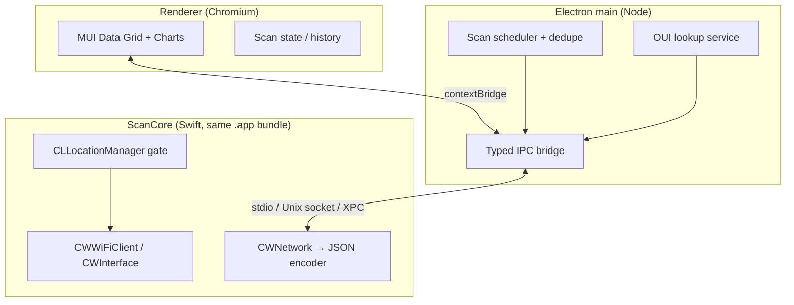

<!-- Extracted from clean-room research. Do not copy Intuitibits assets, binaries, or unique copy. -->
<!-- Source: 7d2d676f-cf0a-4a73-95d7-f792a6ef8d03.jsonl -->

# ScanCore architecture

# Technical architecture: `lv24-Wifi-Explorer`

## Sibling stack check (`/Users/veeskela/Projects`)

| Area         | Stack                                                                                        | Path                                          |
| ------------ | -------------------------------------------------------------------------------------------- | --------------------------------------------- |
| LV24 web     | Vite, React, TypeScript, **MUI Material ~9** + **MUI X 8** (Data Grid Pro, Charts community) | `/Users/veeskela/Projects/lv24/main/frontend` |
| LV24 mobile  | **Flutter** (iOS/Android)                                                                    | `/Users/veeskela/Projects/lv24/main/mobile`   |
| LV24 backend | Node/Nest monorepo                                                                           | `/Users/veeskela/Projects/lv24/main`          |
| Other        | Rust CLI/DB (`ferrum-enterprise`), IMS web                                                   | no desktop shell                              |

**Finding:** No existing **Electron**, **Tauri**, or **native SwiftUI desktop** app in the workspace. The natural UI alignment is **React + MUI + TypeScript + Yarn/Vite**, matching LV24 frontend conventions (license pin for X Pro if you reuse Data Grid Pro).

---

## 1. Recommended process architecture

### Choice: **Electron (main + renderer) + in-bundle Swift ScanCore**



**Why this over alternatives**

| Option                        | Fit for LV24                                                               | macOS Wi‑Fi                                                                                                              | MUI UI                       | Verdict                                         |
| ----------------------------- | -------------------------------------------------------------------------- | ------------------------------------------------------------------------------------------------------------------------ | ---------------------------- | ----------------------------------------------- |
| **Electron + Swift ScanCore** | Reuses TS/MUI/Vite skills from `lv24/main/frontend`                        | CoreWLAN in signed helper inside `.app` (proven pattern, e.g. [macwifi-cli](https://github.com/jaisonerick/macwifi-cli)) | Native in renderer           | **Recommended**                                 |
| Tauri + Rust `corewlan`       | New Rust desktop stack (only Rust in workspace is `ferrum-enterprise` CLI) | Possible via Swift bridge crates                                                                                         | Web UI OK                    | Viable but **does not match** LV24 UI toolchain |
| Pure SwiftUI                  | Best macOS integration                                                     | Direct CoreWLAN                                                                                                          | No MUI; rewrite charts/table | Good macOS-only v1, **poor** LV24 UI reuse      |
| Electron-only (no native)     | Simple                                                                     | **Fails** on modern macOS for BSSID/SSID without signed native code + Location                                           | OK                           | **Not viable**                                  |

**ScanCore shape (pick one; both stay inside `MyApp.app/Contents/Resources/`):**

1. **Long-lived helper process** (preferred): `ScanCore.app` or `lv24-wifi-scancore` launched once by main; speaks **JSON Lines over loopback TCP/Unix domain socket**. Same Team ID as parent Electron app; TCC sees one product.
2. **XPC service** (heavier): cleaner lifecycle, more Xcode plumbing; worth it if you add privileged operations later (you should not for v1).

**Do not** put CoreWLAN in the renderer or in unsigned Node native addons without a proper macOS bundle and signing story—TCC and Location break for ad hoc / unstable identities ([Apple DTS](https://developer.apple.com/forums/thread/718331), [pyobjc #600](https://github.com/ronaldoussoren/pyobjc/issues/600)).

**Future platforms:** Keep **platform adapters** behind the same IPC contract (`ScanAdapter` interface in main). Windows: `wlanapi` / `netsh`; Linux: `nmcli` (limited). Renderer stays unchanged.

---

## 2. How scanning works on macOS 15 / 26 (Sequoia / Tahoe era)

### Supported API surface (no private entitlements)

| Capability       | API                                                                          | Notes                                                                                                                      |
| ---------------- | ---------------------------------------------------------------------------- | -------------------------------------------------------------------------------------------------------------------------- |
| Active scan      | `CWInterface.scanForNetworks(withName:includeHidden:)`                       | Blocking ~**2–4 s** per invocation ([Apple `CWInterface`](https://developer.apple.com/documentation/corewlan/cwinterface)) |
| Cached results   | `cachedScanResults()`                                                        | **Does not** trigger scan; use between full scans                                                                          |
| Live association | `CWWiFiClient` + `CWEventDelegate`                                           | RSSI/noise/SSID for **connected** network; event-driven refresh                                                            |
| Per-BSS fields   | `CWNetwork`: `ssid`, `bssid`, `rssiValue`, `noiseMeasurement`, `wlanChannel` | SSID/BSSID gated by **Location** ([forum r. 108641482](https://developer.apple.com/forums/thread/732431))                  |
| Channel          | `CWChannel`: `channelNumber`, `channelBand`, `channelWidth`                  | Band/width from enums (`CWChannelBand`, `CWChannelWidth` incl. 80/160 MHz)                                                 |
| PHY              | `supportsPHYMode(_:)` over `CWPHYMode` (a/b/g/n/ac/ax/be)                    | **Advertised** modes, not a single “current PHY” field on scan results                                                     |
| Security         | `supportsSecurity(_:)` over `CWSecurity`                                     | **Supported** types; derive display string (Open/WEP/WPA2/WPA3/Enterprise…)                                                |
| Interface meta   | `hardwareAddress()`, `countryCode()`, `noiseMeasurement()` on interface      | Useful for “my radio” panel                                                                                                |

### Explicitly **not** supported paths (avoid)

- **`/usr/libexec/airport`**: removed ~macOS 14.4+; do not depend on copied binaries ([Apple forum](https://developer.apple.com/forums/thread/748161)).
- **`wdutil`**: diagnostics for **current** link; not a substitute for neighborhood scan; BSSID often empty even with `sudo`.
- **`networksetup -listpreferredwirelessnetworks`**: saved profiles, not live scan.
- **IO80211 / private frameworks**: monitor mode, injection, raw frames—**out of scope** and App Review / notarization risk.
- **`com.apple.wifi.events`**: not a generally obtainable third-party entitlement; rely on `CWEventDelegate` in non-sandboxed or correctly entitled builds ([forum](https://developer.apple.com/forums/thread/11307)).

### Scan loop (production)

1. **Gate on Location**: `CLLocationManager` + `startUpdatingLocation()` briefly until authorized (or denied).
2. **Resolve interface**: `CWWiFiClient.shared().interface(withName:)` or default Wi‑Fi interface.
3. **Scan**: `scanForNetworks(withName: nil, includeHidden: true)` on a **background queue** (never block main/UI thread in ScanCore).
4. **Normalize**: Map each `CWNetwork` → `ScanResult`; dedupe by `(bssid || ssid+channel)`; compute SNR = RSSI − noise when both present.
5. **Emit**: Push `ScanSnapshot` to Electron main on interval (e.g. 3–5 s minimum) + on `CWEventType` (power, scan complete, link change).
6. **OUI enrich**: Main process (or ScanCore) resolves vendor from local DB using BSSID OUI.

### Permissions UX

```text
First launch
  → Renderer: explain why Location is required (SSID/BSSID = location-class data on macOS)
  → ScanCore: request Location (When In Use is enough for many apps; Always if you use background agent—prefer When In Use for v1)
  → System Settings prompt (app must appear as signed .app, not raw `electron` dev binary)

If denied
  → Banner + deep link instructions: Settings → Privacy & Security → Location Services → enable globally → enable app
  → Degraded mode: RSSI/channel/noise may appear; SSID/BSSID null (see fallbacks)

Dev workflow
  → `electron-vite dev` unsigned: expect nil SSID/BSSID; document codesign step for local testing
  → CI: unit tests on fixtures; integration tests on signed nightly build only
```

**Plist / entitlements (ScanCore + app bundle):**

- `NSLocationUsageDescription` (macOS) — required ([Apple docs](https://developer.apple.com/documentation/bundleresources/information-property-list/nslocationusagedescription)).
- Optional but often needed in practice: `NSLocationWhenInUseUsageDescription` (and Always variants if you request Always).
- Sandboxed distribution: `com.apple.security.personal-information.location` ([entitlement](https://developer.apple.com/documentation/bundleresources/entitlements/com.apple.security.personal-information.location)).
- **Distribution**: **Developer ID** sign + notarize; stable signing identity across builds (TN3127) for reliable TCC.

**Session constraint:** Scanning must run in the **logged-in Aqua user session**, not a system-wide daemon ([macwifi-cli notes](https://github.com/jaisonerick/macwifi-cli)).

---

## 3. Fallback strategies

| Tier                    | Trigger                                                 | Behavior                                                                                             |
| ----------------------- | ------------------------------------------------------- | ---------------------------------------------------------------------------------------------------- |
| **A – Full**            | Location authorized + scan succeeds                     | All fields populated                                                                                 |
| **B – Cached**          | Scan throttled / in-flight                              | Serve `cachedScanResults()` with `stale: true`                                                       |
| **C – Connected only**  | Scan failed; user on Wi‑Fi                              | Single row from `interface()` SSID/BSSID/RSSI/noise/channel                                          |
| **D – Location denied** | TCC denied                                              | Show channel/RSSI/noise if API returns them; mask SSID/BSSID; prompt to fix permissions              |
| **E – Demo / fixture**  | `--demo` flag or first-run tutorial                     | Replay bundled `fixtures/scan-snapshot.json`; label UI **“Demo data”**                               |
| **F – Import (manual)** | User exports from **Wireless Diagnostics** (Apple tool) | Optional future: parse user-provided diagnostic file **locally**—no automation of Apple private CLIs |

**Never implement:** spoofing Location, parsing other users’ traffic, or bundled deprecated `airport`.

---

## 4. IPC contract (TypeScript types)

Shared package: `@lv24/wifi-explorer-contract` (used by renderer + main; JSON schema for ScanCore).

```typescript
/** Physical band derived from CWChannelBand */
export type WifiBand = '2.4GHz' | '5GHz' | '6GHz' | 'unknown';

export type WifiChannelWidth = '20MHz' | '40MHz' | '80MHz' | '80+80MHz' | '160MHz' | 'unknown';

/** Highest advertised PHY for display; full list in phyModesSupported */
export type WifiPhyMode =
  '802.11a' | '802.11b' | '802.11g' | '802.11n' | '802.11ac' | '802.11ax' | '802.11be' | 'unknown';

export type WifiSecurityLabel =
  | 'Open'
  | 'WEP'
  | 'WPA Personal'
  | 'WPA2 Personal'
  | 'WPA3 Personal'
  | 'WPA Enterprise'
  | 'WPA2 Enterprise'
  | 'WPA3 Enterprise'
  | 'Mixed/Unknown';

export interface ScanResult {
  /** Stable row id: prefer BSSID; else hash(ssid+channel+band) */
  id: string;
  ssid: string | null;
  /** Normalized aa:bb:cc:dd:ee:ff; null if Location denied */
  bssid: string | null;
  rssiDbm: number | null;
  noiseDbm: number | null;
  /** rssi - noise when both present */
  snrDb: number | null;
  channel: number | null;
  channelWidth: WifiChannelWidth;
  band: WifiBand;
  phyMode: WifiPhyMode;
  phyModesSupported: WifiPhyMode[];
  security: WifiSecurityLabel;
  securityRaw: string[];
  /** First 3 octets of BSSID, uppercase hex pairs */
  oui: string | null;
  vendor: string | null;
  hidden: boolean;
  lastSeenAt: string; // ISO-8601
  /** Same SSID may appear on multiple BSSIDs */
  scanGeneration: number;
}

export interface ScanSnapshot {
  snapshotId: string;
  capturedAt: string;
  interfaceName: string;
  countryCode: string | null;
  scanDurationMs: number;
  stale: boolean;
  locationAuthorized: boolean;
  results: ScanResult[];
  error?: ScanError;
}

export type ScanErrorCode =
  | 'LOCATION_DENIED'
  | 'LOCATION_RESTRICTED'
  | 'WIFI_OFF'
  | 'NO_INTERFACE'
  | 'SCAN_FAILED'
  | 'HELPER_UNAVAILABLE'
  | 'TIMEOUT';

export interface ScanError {
  code: ScanErrorCode;
  message: string;
  recoverable: boolean;
}

/** Renderer → main */
export type ScanIpcRequest =
  | { type: 'scan:start'; options?: { includeHidden?: boolean } }
  | { type: 'scan:stop' }
  | { type: 'scan:setIntervalMs'; intervalMs: number }
  | { type: 'permissions:query' }
  | { type: 'permissions:openSettings' }
  | { type: 'demo:enable'; enabled: boolean };

/** Main → renderer (subscribe) */
export type ScanIpcEvent =
  | { type: 'scan:snapshot'; payload: ScanSnapshot }
  | {
      type: 'permissions:status';
      payload: { location: 'authorized' | 'denied' | 'notDetermined' | 'restricted' };
    }
  | { type: 'helper:status'; payload: { running: boolean; version: string } };
```

**Wire format:** JSON Lines or length-prefixed JSON over loopback; version field `protocolVersion: 1` on first message.

---

## 5. Security and privacy

- **Purpose limitation:** Scan and display metadata only; no association, no password cracking, no deauth, no injection, no capture of third-party payload.
- **Location is sensitive:** Copy must state SSID/BSSID are treated as location-related; minimize retention (in-memory + optional user-controlled export); no cloud upload by default.
- **BSSID as persistent identifier:** Avoid logging raw BSSIDs in analytics; if crash reports, hash or strip.
- **Signing:** Ship only notarized Developer ID builds for real BSSID access; warn devs that unsigned local runs behave like “Location broken.”
- **Sandbox:** Mac App Store sandbox is possible with location entitlement but complicates helper/XPC; **direct download** with Hardened Runtime (no unnecessary entitlements) is simpler for a pro tool.
- **OUI database:** Ship **offline** IEEE OUI snapshot; update via app releases, not arbitrary network fetch (optional update channel with signature check).
- **IPC:** Bind helper to `127.0.0.1` + auth token generated at startup; reject non-local peers.

---

## 6. Suggested repo layout

```text
/Users/veeskela/Projects/lv24-Wifi-Explorer/
  package.json                 # yarn workspaces root
  apps/
    desktop/                   # Electron + Vite
      electron/main/           # IPC, scheduler, OUI
      electron/preload/        # contextBridge
      src/                     # React MUI UI (mirror lv24 frontend patterns)
  packages/
    contract/                  # ScanResult types + JSON schema
    oui-db/                    # build script: IEEE CSV → sqlite/json
  native/
    ScanCore/                  # SwiftPM or Xcode project
      Sources/ScanCore/        # CoreWLAN + CoreLocation
      ScanCore.xcodeproj
  resources/
    fixtures/                  # demo snapshots
  scripts/
    codesign-and-notarize.sh
  docs/
    ARCHITECTURE.md
    PERMISSIONS.md
    PARITY-GAP.md              # vs WiFi Explorer Pro features
```

Align lint/tooling with `lv24/main/frontend` where cheap (oxlint, vitest, MUI license init for Data Grid Pro if used).

---

## 7. Risks vs WiFi Explorer (parity blockers)

| WiFi Explorer–class feature                 | Feasibility on public macOS APIs                                                                                                        |
| ------------------------------------------- | --------------------------------------------------------------------------------------------------------------------------------------- |
| **Spectrum analyzer / channel utilization** | **Blocked** — monitor mode removed from public CoreWLAN (`supportsMonitorMode` removed); needs hardware analyzer or non-App-Store hacks |
| **Remote capture / 802.11 decode**          | **Blocked in-app** — use external Wireshark; BPF capture is separate product surface                                                    |
| **Sub-ms RSSI streaming**                   | **Limited** — scan rate ~0.3–0.5 Hz; connected link RSSI via events is faster but one BSS only                                          |
| **Exact negotiated cipher / PMF / AKM**     | **Partial** — only `supportsSecurity` flags on scan results                                                                             |
| **6 GHz / multi-link detail**               | **Variable** — depends on OS/driver exposing via `CWNetwork`; test on Apple Silicon + Tahoe                                             |
| **Hidden SSID discovery**                   | **OK** with `includeHidden: true`; may still miss some probes                                                                           |
| **Rogue / evil twin automation**            | **Policy** — display only; no offensive tooling                                                                                         |
| **Location denied environments**            | **Degraded** — enterprise-locked Macs may block Location for non-MDM apps                                                               |
| **App Store vs direct**                     | Sandbox + review may constrain helper design                                                                                            |

**Realistic v1 parity:** Neighborhood table, signal/noise charts, channel/band/width/PHY/security columns, vendor column, live refresh, connected-BSS detail panel—**not** spectrum/w sniffing/monitor mode.

---

## Summary decision

Build **`lv24-Wifi-Explorer` as Electron + React/MUI** to match `/Users/veeskela/Projects/lv24/main/frontend`, with a **signed Swift ScanCore** using **CoreWLAN + CoreLocation** inside the same app bundle. Treat **Location + Developer ID signing** as part of the core feature, not an optional extra. Keep scanning behind a **versioned TypeScript IPC contract** so Windows/Linux adapters can plug in later without touching the MUI renderer.

[REDACTED]
